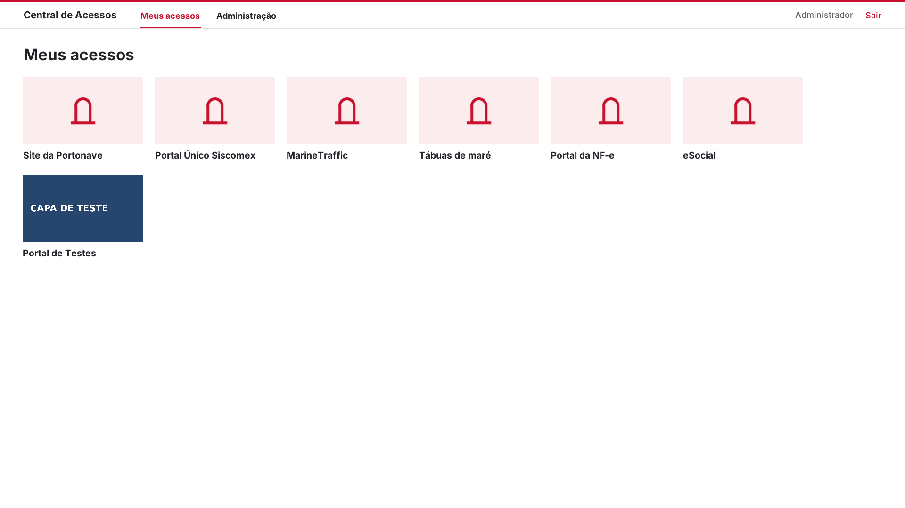
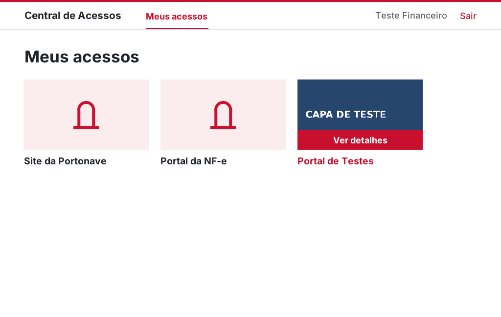
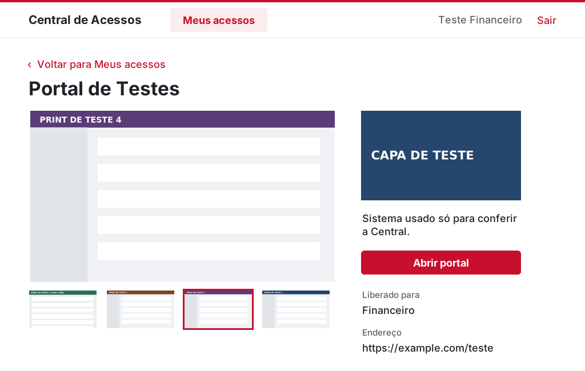

# Central de Acessos

**Um catálogo de atalhos para os sites e sistemas que cada setor usa no trabalho.**

Projeto acadêmico independente, desenvolvido no SENAI para apresentação à Portonave. A proposta parte de um problema simples: quando cada ferramenta fica em um endereço diferente, encontrar o portal certo toma tempo. A Central reúne esses endereços numa tela e mostra a cada pessoa os atalhos liberados para o seu setor.

[Como executar](#como-executar-no-windows) · [Como funciona](#como-funciona) · [Entenda o código](#entenda-o-código) · [Roteiro da apresentação](ROTEIRO_APRESENTACAO.md)



## Como funciona

A ideia é a de um quarto com portais. O administrador cadastra cada atalho com nome, endereço, descrição, capa, até 4 prints e os setores que podem vê-lo. Na tela **Meus acessos**, o funcionário encontra as capas dos portais do próprio setor.

- Clicar na capa ou no nome abre o endereço original no navegador padrão.
- Com o mouse em cima da capa, aparece a faixa **Ver detalhes**. Ela leva à página do sistema, com os prints, a descrição e o botão **Abrir portal**.

| Quem usa | O que pode fazer |
| --- | --- |
| **Funcionário** | Consultar seus atalhos, ver os detalhes e os prints, e abrir os destinos. |
| **Administrador** | Cadastrar, editar e remover portais, gerenciar setores e funcionários e escolher onde cada atalho aparece. |

O cadastro fica salvo no computador entre as execuções. Cada sistema de destino continua responsável pelo seu login e pelas suas permissões.

| Capa com o mouse em cima | Página de detalhes |
| --- | --- |
|  |  |

## Como executar no Windows

1. Instale o [Python](https://www.python.org/downloads/) com o componente **Tcl/Tk and IDLE**.
2. Baixe o repositório como ZIP e extraia a pasta inteira.
3. Abra **`abrir_central.bat`**. Na primeira vez ele instala o **Pillow**, a biblioteca que ajusta o tamanho das imagens (precisa de internet). Depois a Central abre maximizada, na tela de entrada.

Se preferir o terminal, rode na pasta do projeto:

```powershell
py -m pip install -r requirements.txt
py central.py
```

### Gerar o executável (.exe)

Dê dois cliques em **`gerar_executavel.bat`**. Ele instala o PyInstaller e cria **`dist\CentralDeAcessos.exe`**, que abre sem precisar do Python instalado. O `.exe` lê o `dados.json` da pasta em que ele estiver, então copie o `dados.json` para junto do `.exe`.

O PyInstaller só gera `.exe` rodando no Windows. Por isso esse passo precisa ser feito num computador com Windows.

### Ao vivo para várias pessoas

Para todo mundo ver as mesmas informações, os dados ficam numa **pasta compartilhada da rede** da empresa:

1. Crie uma pasta na rede que todos consigam abrir, por exemplo `\\servidor\central`, e coloque o `dados.json` dentro dela.
2. No começo do `cadastro.py`, escreva o caminho dessa pasta, com barras normais e uma barra no fim:
   ```python
   PASTA = "//servidor/central/"
   ```
3. Abra a Central normalmente em cada computador. Se for usar o `.exe`, gere ele depois de mudar o `PASTA`.

A cada 3 segundos, cada Central lê o `dados.json` como texto e compara com a última vez. Se mudou, recarrega e redesenha a tela. Quando o administrador libera um portal, ele aparece para quem está conectado sem precisar fechar nada. Quem está preenchendo um formulário não é interrompido: a tela só atualiza quando a pessoa sai dele.

Com `PASTA = ""`, os dados ficam na pasta do próprio programa.

> Deixe **uma pessoa administrando por vez**. Se dois administradores salvarem ao mesmo tempo, o último a salvar sobrescreve o outro.

O `dados.json` já vem com os setores, as contas abaixo e seis sistemas públicos cadastrados: Site da Portonave, Portal Único Siscomex, MarineTraffic, Tábuas de maré, Portal da NF-e e eSocial. Eles ainda não têm capa nem prints; isso se adiciona pela Administração.

<details>
<summary><strong>Contas para o ensaio</strong></summary>

| Usuário | Senha | Papel |
| --- | --- | --- |
| `admin` | `admin123` | Administração |
| `teste.financeiro` | `teste123` | Financeiro |
| `teste.operacoes` | `teste123` | Operações |

As contas de teste podem ser apagadas na aba **Funcionários** depois da apresentação. A senha do `admin` também deve ser trocada.

</details>

### Capas e prints

Aceita **PNG ou JPG** de qualquer tamanho. O Pillow aumenta ou diminui a imagem até ela preencher todo o espaço. Se a proporção for diferente de 16:9, ele corta um pouco da parte de baixo, para o topo do sistema (nome e menu) continuar aparecendo. Prints da tela inteira, tirados com **Windows + Shift + S**, ficam bons.

O programa guarda o caminho da imagem escolhida. Por isso, deixe as imagens numa pasta fixa (por exemplo, a pasta `imagens` do projeto) e não apague nem mova depois de cadastrar. Se uma imagem sumir, a Central mostra o desenho padrão no lugar, sem dar erro. No modo ao vivo, escolha imagens que estejam na pasta da rede, para todos os computadores enxergarem.

## Demonstração

1. Entre como administrador e cadastre um portal com capa e prints. Libere o atalho apenas para o **Financeiro**.
2. Entre com a conta do Financeiro. Passe o mouse na capa, abra **Ver detalhes**, troque os prints pelas miniaturas e clique em **Abrir portal**.
3. Entre com a conta de Operações e confira que o portal não aparece.
4. Volte à Administração, libere o mesmo portal para **Operações** e entre novamente nessa conta. Feche e reabra a Central para conferir o cadastro salvo.

O [roteiro completo da apresentação](ROTEIRO_APRESENTACAO.md) inclui a ordem das telas e sugestões de como explicar a lógica.

## Entenda o código

**Python · Tkinter · JSON**

| Arquivo | Responsabilidade |
| --- | --- |
| [`acessos.py`](acessos.py) | Filtra os portais pelo setor do funcionário. É o melhor ponto para começar a leitura. |
| [`cadastro.py`](cadastro.py) | Lê e grava o `dados.json` (`json.load` lê, `json.dump` grava). Tem 35 linhas. |
| [`central.py`](central.py) | Monta as telas, liga os botões às ações e abre os endereços no navegador. Está dividido em blocos: Entrada, Meus acessos, Detalhes, Administração e Ao vivo. |

O filtro percorre os portais e inclui cada atalho quando o setor da pessoa está entre os liberados:

```python
elif usuario["setor"] in portal["setores"]:
    liberados.append(portal)
```

O clique na capa usa um `if` para saber onde o mouse estava:

```python
if evento.y > CAPA_ALTURA - FAIXA:
    tela_detalhes(portal)  # clicou na faixa
else:
    abrir_portal(portal)  # clicou na imagem
```

Abrir o portal usa a biblioteca padrão do Python:

```python
webbrowser.open(portal["endereco"])
```

E o "ao vivo" é uma função que lê o arquivo, compara com a última vez e pede pro Tkinter chamar ela de novo em 3 segundos:

```python
texto_agora = cadastro.ler_texto()
if texto_agora != ultimo_texto:
    ultimo_texto = texto_agora
    dados = cadastro.texto_para_dados(texto_agora)
    atualizar_tela()
janela.after(SEGUNDOS_PARA_CONFERIR * 1000, acompanhar_mudancas)
```

Além de `if`, `elif` e `else`, o código usa `def`, listas, dicionários, `for` e `lambda` (nos botões: "quando clicar, rode isto"). Os botões arredondados são desenhados num `Canvas`, porque o Tkinter não tem botão com canto redondo.

## Testes

O programa foi aberto e as telas foram controladas por um roteiro de teste. Tudo passou:

- **Cadastro:** um portal com capa e 4 prints, liberado só para o Financeiro, é salvo no `dados.json`. Com 4 prints o botão de adicionar some, e "Tirar" libera de novo.
- **Imagens:** um print de 1440 × 900 (proporção diferente) preenche o espaço todo, sem bordas.
- **Financeiro:** a conta vê o portal. Nome e capa abrem o endereço, e a faixa aparece e some com o mouse. A faixa leva aos detalhes sem abrir o navegador, as miniaturas trocam o print grande e **Abrir portal** abre o endereço.
- **Operações:** não vê o portal até o administrador liberar. Depois de liberado, vê.
- **Persistência:** depois de fechar e reabrir, portal, permissões e funcionários novos continuam salvos.
- **Outros casos:** senha errada é recusada, funcionário não vê a Administração, e uma conta nova do Comercial vê só os sistemas do Comercial.
- **Ao vivo:** dois programas abertos usando a mesma pasta. O admin liberou um portal num deles e ele apareceu sozinho no outro. O admin removeu uma conta e ela voltou sozinha para a tela de entrada. Um formulário aberto não foi interrompido, e a mudança apareceu logo depois de sair dele.
- **Telas:** conferidas em 1024 × 650 e em 1920 × 1080.

As capturas foram tiradas no Linux, com fonte parecida com a Segoe UI. As imagens com "TESTE" escrito foram feitas só para o teste. Os endereços dos seis sistemas iniciais não puderam ser abertos no ambiente de teste e devem ser conferidos antes da apresentação. O `gerar_executavel.bat` não foi testado, porque o `.exe` só pode ser gerado no Windows.

## Escopo acadêmico

Esta versão roda no computador de cada pessoa, com os dados numa pasta local ou compartilhada. O filtro por setor organiza a **visibilidade dos atalhos na Central**; quem souber um endereço ainda consegue abri-lo direto no navegador, e por isso o login de cada sistema continua valendo. As contas são gravadas em texto no arquivo `dados.json`, e quem tiver acesso à pasta consegue ler esse arquivo. Para uma implantação interna, a autenticação e a gestão de contas precisariam ser avaliadas com a equipe de TI da empresa.

Em 1024 × 650 a tela Meus acessos mostra 6 capas; com mais portais seria preciso adicionar rolagem. O vermelho `#C8102E` é provisório e fica na variável `VERMELHO`, no começo do `central.py`.

## Apoio no desenvolvimento
