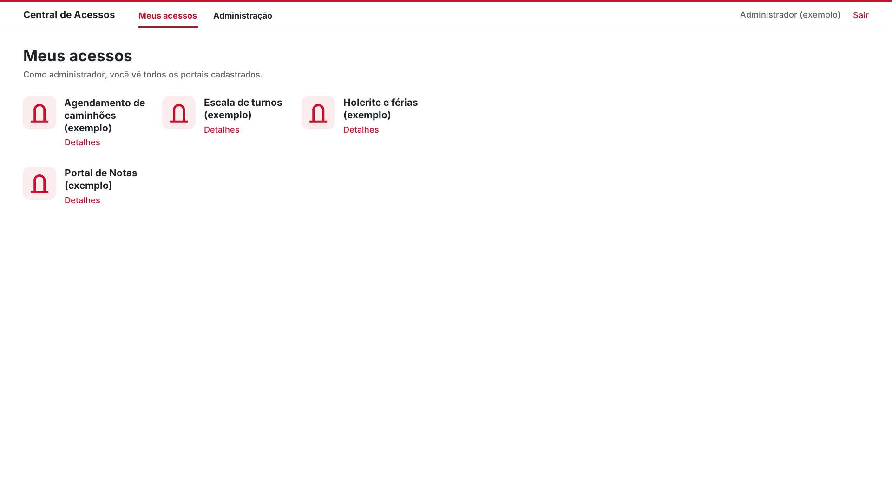

# Central de Acessos

**Um catálogo de atalhos para os sites e sistemas que cada setor usa no trabalho.**

Projeto acadêmico desenvolvido no SENAI para apresentação à Portonave. A proposta parte de um problema simples: quando cada ferramenta fica em um endereço diferente, encontrar o portal certo toma tempo. A Central reúne esses endereços numa tela e mostra a cada pessoa os atalhos liberados para o seu setor.

[Como executar](#como-executar-no-windows) · [Como funciona](#como-funciona) · [Entenda o código](#entenda-o-código) · [Roteiro da apresentação](ROTEIRO_APRESENTACAO.md)



## Como funciona

A ideia é a de um quarto com portais. O administrador cadastra cada atalho com nome, endereço, descrição, imagem opcional e os setores que podem vê-lo. Na tela **Meus acessos**, o funcionário encontra os portais do próprio setor. Clicar no nome ou na imagem abre o endereço original no navegador padrão. O botão **Detalhes** mostra para que serve aquele portal.

| Quem usa | O que pode fazer |
| --- | --- |
| **Funcionário** | Consultar seus atalhos, ler os detalhes e abrir os destinos. |
| **Administrador** | Cadastrar, editar e remover portais, gerenciar setores e funcionários e escolher onde cada atalho aparece. |

O cadastro fica salvo no computador entre as execuções. Cada sistema de destino continua responsável pelo seu login e pelas suas permissões.

## Como executar no Windows

1. Instale o [Python](https://www.python.org/downloads/) com o componente **Tcl/Tk and IDLE**.
2. Baixe o repositório como ZIP e extraia a pasta inteira.
3. Abra **`abrir_central.bat`**. A Central abre maximizada, na tela de entrada.

Se preferir o terminal, rode na pasta do projeto:

```powershell
py central.py
```

<details>
<summary><strong>Contas de exemplo para o ensaio</strong></summary>

| Usuário | Senha de exemplo | Papel |
| --- | --- | --- |
| `admin` | `admin123` | Administração |
| `ana` | `ana123` | Financeiro |
| `bruno` | `bruno123` | Operações |

Na primeira execução, o programa cria `dados.json` com essas contas e portais de exemplo. Os atalhos iniciais apontam para `example.com`.

</details>

## Demonstração

1. Entre como administrador e cadastre um **Portal de Notas** com um endereço de ensaio. Libere o atalho apenas para o **Financeiro**.
2. Entre com a conta do Financeiro. Abra **Detalhes**, confira a descrição e clique no portal para abrir o endereço.
3. Entre com a conta de Operações e confira a lista desse setor.
4. Volte à Administração, libere o mesmo portal para **Operações** e entre novamente nessa conta. Feche e reabra a Central para conferir o cadastro salvo.

O [roteiro completo da apresentação](ROTEIRO_APRESENTACAO.md) inclui a ordem das telas e sugestões de como explicar a lógica.

## Entenda o código

**Python · Tkinter · JSON**

| Arquivo | Responsabilidade |
| --- | --- |
| [`acessos.py`](acessos.py) | Filtra os portais pelo setor do funcionário. É o melhor ponto para começar a leitura. |
| [`cadastro.py`](cadastro.py) | Carrega e salva os cadastros em `dados.json`. |
| [`central.py`](central.py) | Monta as telas, liga os botões às ações e abre os endereços no navegador. |

O filtro percorre os portais e inclui cada atalho quando o setor da pessoa está entre os liberados:

```python
elif usuario["setor"] in portal["setores"]:
    liberados.append(portal)
```

O clique usa a biblioteca padrão do Python para abrir o endereço cadastrado:

```python
webbrowser.open(portal["endereco"])
```

## Escopo acadêmico

Esta versão roda localmente e usa contas e endereços de exemplo. O filtro por setor organiza a **visibilidade dos atalhos na Central**. As contas de ensaio são gravadas em texto no arquivo local `dados.json`. Para uma implantação interna, a autenticação e a gestão de contas precisariam ser avaliadas com a equipe de TI da empresa.

A Central é um projeto acadêmico independente, apresentado à Portonave no contexto do SENAI.

## Apoio no desenvolvimento

<a href="https://www.anthropic.com/claude-code"></a>
<strong>Claude Code · Anthropic</strong>

O Claude Code foi utilizado como ferramenta de apoio ao desenvolvimento e à documentação. [Ícone do Claude Code via LobeHub Icons](https://dashboardicons.com/icons/external/lobehub/claudecode).
